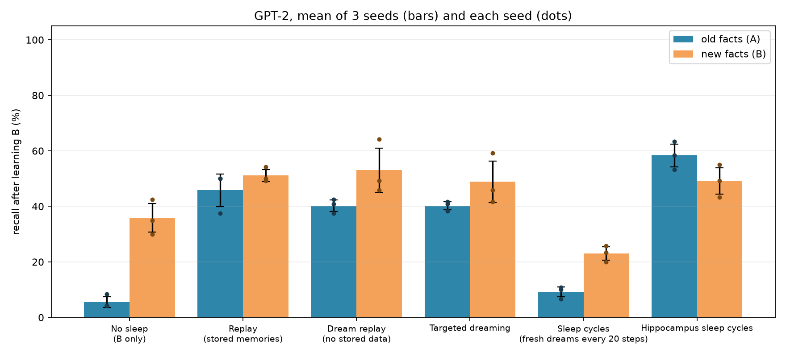

# Can AI learn to sleep?

Code and results for the blog post **[Can AI learn to sleep? What the brain's memory replay teaches us about catastrophic forgetting](https://woletee.github.io/diffusion-papers-/can-ai-learn-to-sleep/)**.

GPT-2 learns 120 invented facts (set A), then 120 new ones (set B). Without help it forgets almost all of set A. This repo tests six ways of learning set B, several of them borrowed from how the brain replays memories during sleep.

[](https://colab.research.google.com/github/woletee/can-ai-learn-to-sleep/blob/main/sleep_experiment.ipynb)



## Results (GPT-2, 3 seeds)

Recall after 120 training steps on set B. Mean over seeds 0, 1 and 2, with the lowest and highest seed in brackets. Before learning set B, the model recalled 98% of set A.

| Condition | Old facts (A) | New facts (B) |
|---|---|---|
| No sleep (train on B only) | 6% (4–8) | 36% (30–42) |
| Replay (stored real A facts) | 46% (38–50) | 51% (49–54) |
| Dream replay (model's own samples, no stored data) | 40% (38–42) | 53% (46–64) |
| Targeted dreaming (keep the least-certain dreams) | 40% (38–42) | 49% (42–59) |
| Sleep cycles (fresh dreams every 20 steps from the current model) | 9% (7–11) | 23% (20–26) |
| **Hippocampus cycles** (fresh dreams every 20 steps from a frozen copy) | **58% (53–63)** | 49% (43–55) |

In short: dreams nearly match real stored data; dreaming from a model that is already forgetting fails; a separate frozen copy to dream from works best.

## Run it

```bash
pip install -r requirements.txt
python sleep_experiment.py                 # GPT-2, seed 0, about 50 minutes on a laptop CPU
SLEEP_QUICK=1 python sleep_experiment.py   # a few-minute smoke test
```

Settings are environment variables:

| Variable | Default | Meaning |
|---|---|---|
| `SLEEP_MODEL` | `gpt2` | Any Hugging Face causal LM, e.g. `Qwen/Qwen2.5-0.5B` |
| `SLEEP_METHOD` | `full` | `full` fine-tuning or `lora` |
| `SLEEP_SEED` | `0` | Changes the invented facts, training order and dreams |
| `SLEEP_QUICK` | off | `1` for a tiny, fast run |
| `SLEEP_CACHE` | off | `1` to reuse the phase-1 checkpoint (`checkpoint_A.pt`) |
| `SLEEP_ONLY` | all | Run one condition and merge it into an existing `results.json` |

Each run writes `results/<model>-<method>[-seed<N>]/` with `results.json`, `forgetting_curves.png` and `final_recall.png`. After running several seeds, `python aggregate_seeds.py` makes the summary table and `results/seeds_summary.png`. `run_seeds.ps1` (Windows) runs seeds 1 and 2 back to back.

The notebooks are generated from the script with `python build_notebook.py`:

- `sleep_experiment.ipynb`: GPT-2, same as the script.
- `sleep_experiment_qwen.ipynb`: Qwen2.5, full fine-tuning or LoRA, sized for a free Colab GPU.

## Setup details

| Setting | Value |
|---|---|
| Facts | 120 per set, invented words, 3 sentence templates |
| Learning set A | 30 epochs, learning rate 5e-5, 10 warm-up steps, batch 16 |
| Learning set B | 120 steps for every condition |
| Replay share | 25% of each batch |
| Dreams | 30 per night, sampled from "Fact:" prompts |
| Nights (cycles) | every 20 steps |
| Recall test | greedy decoding, exact match on the answer's first word |

Limits: one small model, invented facts, exact-match scoring and three seeds. General-English perplexity rises sharply in every condition, because only facts are replayed. See "Where does the sleep analogy break?" in the post.

## License

MIT
